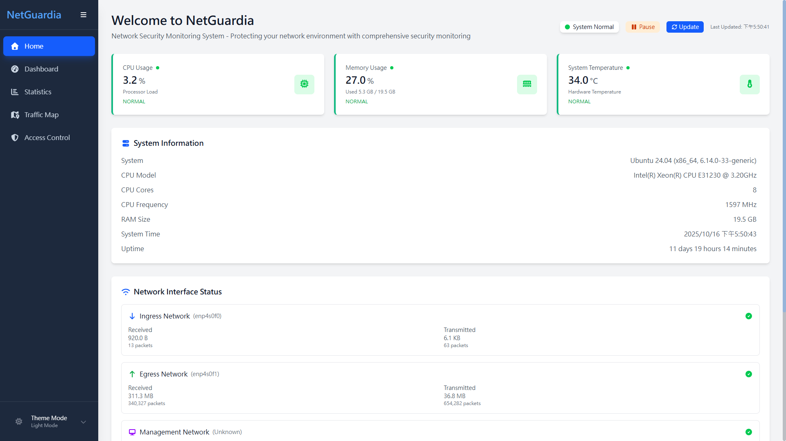
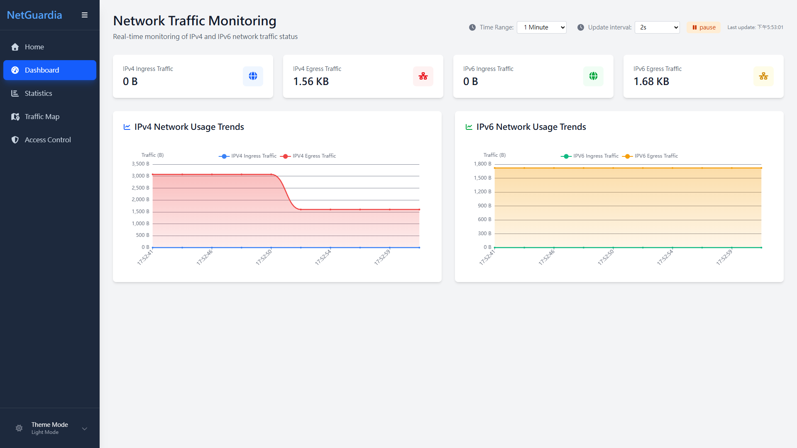
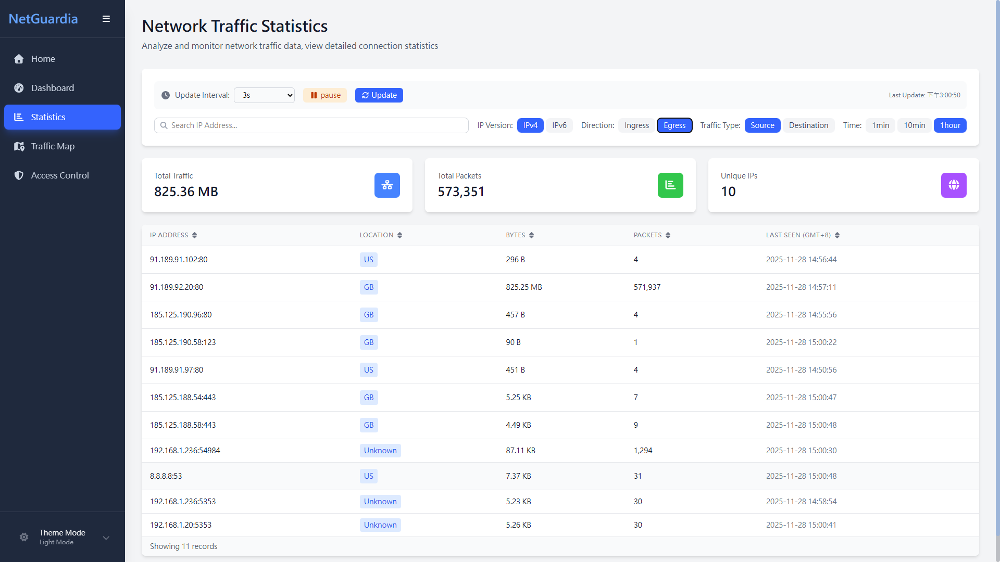
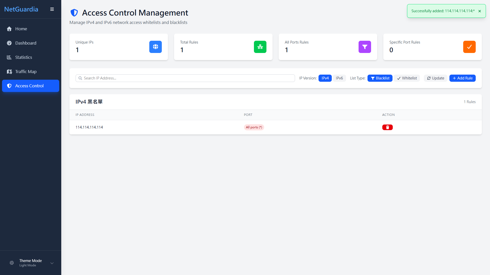

# NetGuardia

## Project Overview

**NetGuardia** is a high-performance network security solution that combines eBPF XDP technology with deep learning models to provide advanced network protection. The system operates as a standalone network appliance that can run on any Ubuntu-based system with compatible network hardware.

## Core Technologies

- **eBPF XDP Technology** - Provides high-performance packet processing directly at the data link layer
- **Deep Learning Models** - Identifies and predicts potential network attacks with intelligent threat detection
- **Hardware Integration** - Designed to work with Intel i350 T2 and similar enterprise-grade network interface cards

## Functional Modules

### Resource Overview

- Real-time control system occupancy rate

### Dashboard Overview

- Real-time network traffic monitoring and visualization
- Recent traffic statistics and trend analysis

### Detailed Traffic Statistics

- Detailed traffic usage information per IP address

### Network Access Control

- IPv4/IPv6 whitelist and blacklist management
- Precise port-level access control

[//]: # (### AI Attack Detection)

[//]: # (![AI 攻擊偵測介面]&#40;.github/images/aiDetection.png&#41;)

[//]: # (- AI-based attack detection engine)

## System Features

- **High Performance** -  Low-latency packet processing with minimal network performance impact
- **User-Friendly** - Cross-platform web management interface with intuitive operation
- **Reliability** - Hardware-accelerated processing ensures stable operation
- **Scalability** - Modular design supports functional expansion

## System Requirements

NetGuardia requires the combination of a kernel with eBPF support and a NIC driver
that implements **AF_XDP** on that kernel. There is no single "minimum kernel
version" — it depends on which NIC driver you use.

- **Linux** with eBPF + AF_XDP support for your NIC driver. Any modern distribution
  (Ubuntu 22.04+, Debian 12+, RHEL 9+, Fedora recent) is fine as long as the driver
  matrix below lines up.
- **Dual-port NIC** with an AF_XDP-capable driver (see matrix).
- **Root / sudo** access for eBPF program loading.

### NIC driver / kernel matrix (AF_XDP)

| Driver | NIC family (examples) | Min kernel for AF_XDP |
|--------|-----------------------|------------------------|
| mlx5   | Mellanox ConnectX-4/5/6/7 | 5.x (early) |
| ixgbe  | Intel 82599, X520, X540, X550 | 5.x |
| i40e   | Intel X710, XL710, XXV710 | 5.x |
| ice    | Intel E810 | 5.5+ |
| igb    | **Intel i350 T2** (reference hardware) | **6.17** |
| igc    | Intel I225/I226 | 6.x |
| virtio_net | QEMU/KVM virtual NICs | varies; AF_XDP is limited |

If you are using the reference Intel i350 T2, you need Linux 6.17 or newer because
igb AF_XDP support landed in that release. On a kernel older than 6.17 the system
will still build, but `ingress`/`egress` setup will fail at runtime when AF_XDP
binding is attempted — check driver support with `ethtool -i <iface>` and confirm
against the matrix above before deploying.

## Hardware Compatibility

- Network Interface: dual-port NIC with an AF_XDP-capable driver on your kernel
  (see matrix above). Intel i350 T2 is the reference hardware.
- CPU: multi-core recommended; XDP scales with RX queue count.
- Memory: 8 GB minimum, 16 GB+ for high-traffic environments.

NetGuardia is not limited to embedded platforms — it runs on standard server
hardware, virtual machines, or dedicated appliances as long as the driver/kernel
requirement above is met.

